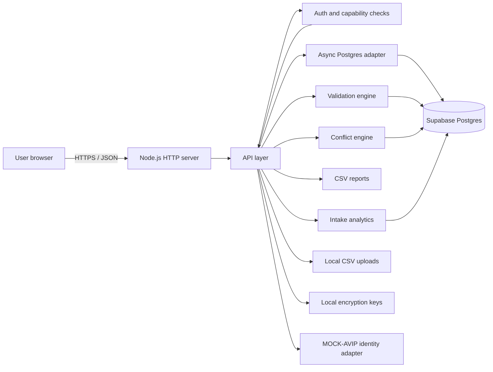
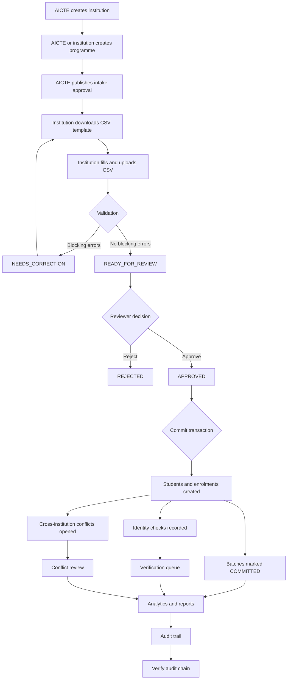
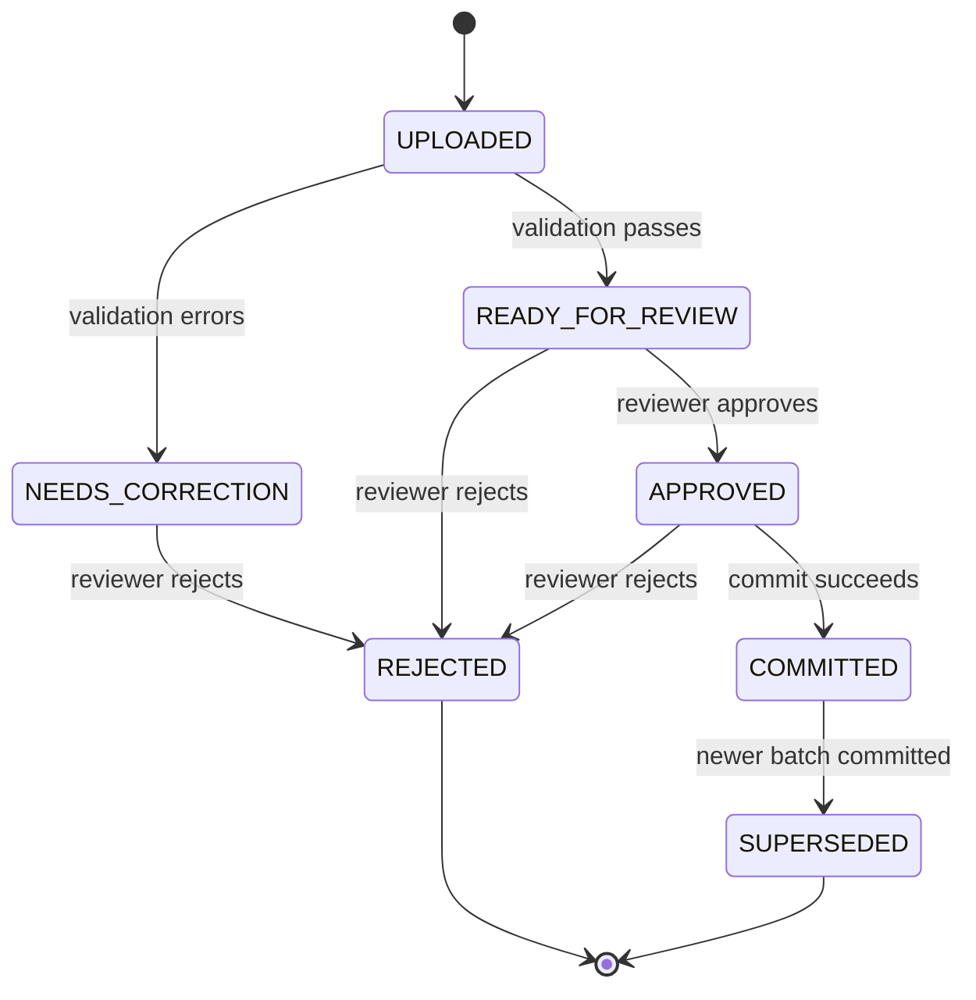

# AVIP - Project Explanation, Current Status and Workflow

**AVIP = APAAR Verify Intelligence Platform**

AVIP is a working prototype for **AICTE problem statement 26263**. It is a controlled enrolment-integrity platform that validates institution submissions, protects approved intake, verifies identity references, detects cross-institution conflicts, and produces tamper-evident audit evidence.

> This is a prototype. All data is synthetic. Identity verification is simulated. There is no live APAAR, ABC, DigiLocker, AICTE or government integration.

---

## 1. The problem AVIP addresses

Institutions submit student enrolment data in many different formats. Common problems are:

- Wrong or malformed APAAR identifiers.
- Duplicate students inside one file.
- The same student claimed by more than one institution.
- Enrolments that exceed approved intake.
- Category seats exceeding their approved caps.
- Data corrected without a reliable history of who changed what.
- Files uploaded twice, creating duplicate batches.
- No clear separation between data entry, review, approval and verification.
- Weak evidence when an auditor asks, "How was this enrolment approved?"

Most existing systems solve only one part: a college ERP stores student records, a portal accepts forms, an identity API verifies one identifier, and a spreadsheet tracks intake. AVIP connects these steps into one controlled workflow with evidence.

---

## 2. What AVIP currently does

AVIP currently provides an end-to-end, role-based workflow:

1. Maintains institutions, programmes and approved intake rules.
2. Accepts enrolment data as a CSV file.
3. Validates every row against format, programme, year, duplicate and capacity rules.
4. Stages valid and invalid rows with row-level issues.
5. Requires a reviewer to approve or reject a batch.
6. Commits an approved batch atomically into students and enrolments.
7. Runs simulated identity verification for new enrolments.
8. Opens conflict cases when the same student appears in another institution in the same academic year.
9. Provides conflict assignment and resolution.
10. Produces intake utilisation analytics and CSV reports.
11. Records privileged actions in a SHA-256 hash-chained audit trail.
12. Lets an authorised user verify the audit chain.
13. Scopes all data and actions by role and institution.

### Current runtime status

| Area | Current state |
|---|---|
| Database | Migrated from SQLite to **Supabase Postgres** using the `pg` driver |
| Schema | Applied automatically on startup from `src/schema.sql` |
| Demo data | Seeded automatically when the database is empty |
| Connection | `.env` exists but `DATABASE_URL` is still empty; a Supabase URL must be supplied |
| Tests | Static syntax checks pass; the end-to-end test skips until `DATABASE_URL` is configured |
| Identity provider | Simulated `MOCK-AVIP` adapter |
| File storage | CSV uploads remain on local disk under `data/uploads/` |
| Frontend | Vanilla JavaScript single-page application |
| Authentication | Session cookie + scrypt password hashing + demo MFA |
| Audit | Hash-chained events with serialized appends and chain verification |
| Row security | Postgres Row Level Security enabled with no policies, blocking the public Supabase Data API |

In short: the application code is migration-ready for Supabase, but live end-to-end execution still needs a real database connection string.

---

## 3. Who uses AVIP

AVIP has six roles. Capabilities are enforced on the server, not only hidden in the UI.

| Role | Main purpose | Typical actions |
|---|---|---|
| AICTE Administrator | National oversight and rule setting | Manage institutions, programmes and intake approvals; review conflicts; verify audit; export reports |
| Institution Administrator | Manage one institution | Create programmes, submit imports, correct enrolments, verify identity, view reports and its own audit |
| Institution Data Submitter | Prepare and upload data | Download template, upload CSV, view staged batches, view students and reports |
| Verification Officer | Resolve identity and conflict exceptions | Run identity checks, assign and resolve conflict cases |
| Auditor | Independent read-only evidence review | View records, conflicts, reports and audit trail; verify audit integrity |
| System Operator | Operational health and reporting | View health and reports; read-only |

### Demo accounts

All accounts use password `Demo@1234`.

| Email | Role | MFA |
|---|---|---|
| `admin@aicte.demo` | AICTE Administrator | `246810` |
| `registrar@sit.demo` | Institution Administrator | Not required |
| `submitter@sit.demo` | Data Submitter | Not required |
| `registrar@nce.demo` | Institution Administrator | Not required |
| `verifier@aicte.demo` | Verification Officer | Not required |
| `auditor@aicte.demo` | Auditor | Not required |
| `operator@aicte.demo` | System Operator | Not required |

---

## 4. High-level architecture



### Technology choices

| Layer | Current implementation |
|---|---|
| Server | Node.js built-in `http` |
| API | `/api/v1` route handlers in `src/api.js` |
| Database | Supabase Postgres through `pg` |
| Transactions | AsyncLocalStorage transaction context |
| Frontend | HTML, CSS and vanilla JavaScript single-page app |
| Auth | HttpOnly session cookie, SameSite=Strict, eight-hour expiry |
| Password storage | `scrypt` with random salt |
| APAAR protection | AES-256-GCM encryption plus HMAC-SHA256 lookup token |
| Audit | SHA-256 hash chain with `seq BIGSERIAL` ordering |
| Seed data | Synthetic institutions, users, students, batches and audit events |

### Why this architecture is suitable for a prototype

- Minimal runtime dependencies: only `pg`.
- No build step and no frontend framework.
- Easy to run locally and demonstrate.
- Database is hosted, so multiple devices can use the same data.
- The database adapter hides Postgres details from business logic.
- The core business rules are deterministic and testable.

---

## 5. Data model

The main tables are:

| Table | What it stores |
|---|---|
| `institutions` | Institution directory and approval status |
| `institution_users` | Users, roles, password hashes, MFA flag and institution scope |
| `programmes` | Programmes offered by an institution |
| `intake_approvals` | Approved intake, category caps, effective dates and rule version |
| `students` | Privacy-protected student identity record |
| `import_batches` | One uploaded CSV file, its hash, status, counts and rule version |
| `import_rows` | Staged rows with normalized payloads and validation state |
| `validation_issues` | Row-level and file-level validation findings |
| `enrolments` | The committed enrolment record linked to student, programme and institution |
| `identity_checks` | Provider results and reason codes |
| `conflict_cases` | Cross-institution or duplicate cases requiring review |
| `conflict_case_items` | Enrolments linked to a conflict case |
| `audit_events` | Append-only, hash-chained audit evidence |
| `outbox_events` | Integration events staged for future delivery |
| `api_clients` | Reserved for future API access |
| `sessions` | Hashed session tokens and expiry |

### Key design choices

- APAAR is **not stored as plain text** in student records.
- A deterministic HMAC token enables matching without revealing the identifier.
- Raw APAAR values are masked in API responses and the UI.
- Imported files are hashed with SHA-256 for integrity.
- Enrolments and institutions use version numbers for optimistic concurrency.
- Audit events are ordered by `seq` and linked by `previous_event_hash`.

---

## 6. End-to-end workflow



### Step 1 - Establish the control data

An AICTE administrator creates or approves an institution. Programmes are added under that institution. Before any import can be committed, an intake approval must exist for the programme and academic year.

The approval contains:

- Approved intake number.
- Supernumerary rules.
- Category caps.
- Effective dates.
- Rule version.
- Approval reference.

Publishing a new approval supersedes the previous active approval for the same programme and academic year.

### Step 2 - Institution downloads the template

The CSV template contains these columns:

```text
apaar_id,full_name,date_of_birth,programme_code,academic_year,roll_number,admission_date,seat_type,admission_category,nri_status,oci_status,foreign_national_status
```

### Step 3 - Upload and validate

The upload endpoint:

1. Requires an `Idempotency-Key` of 6 to 120 characters.
2. Checks that the programme exists and is in the user's scope.
3. Requires an active intake approval for the programme and year.
4. Rejects files larger than 5 MB.
5. Stores the file locally with a SHA-256 digest.
6. Creates an import batch.
7. Runs validation synchronously.

### Step 4 - Validation rules

File-level checks:

- Required headers are present.
- The file contains data rows.
- Processing errors mark the batch `NEEDS_CORRECTION`.

Row-level error checks:

| Code | Meaning |
|---|---|
| `E_APAAR_REQUIRED` | APAAR is missing |
| `E_APAAR_FORMAT` | APAAR is not 12 digits in this synthetic prototype |
| `E_NAME_REQUIRED` | Student name is missing |
| `E_DOB_INVALID` | Date of birth is invalid or in the future |
| `E_PROGRAMME_REQUIRED` | Programme code is missing |
| `E_PROGRAMME_MISMATCH` | Row programme does not match the batch programme |
| `E_YEAR_REQUIRED` | Academic year is missing |
| `E_YEAR_INVALID` | Academic year format is wrong |
| `E_YEAR_MISMATCH` | Row year does not match the batch year |
| `E_ROLL_REQUIRED` | Roll number is missing |
| `E_ROLL_DUPLICATE_BATCH` | Roll number appears twice in the file |
| `E_ADMISSION_DATE_INVALID` | Admission date is invalid |
| `E_SEAT_TYPE_INVALID` | Seat type is not allowed |
| `E_CATEGORY_INVALID` | Admission category is not allowed |
| `E_TRI_STATE_INVALID` | NRI/OCI/foreign status is not YES, NO or NOT_APPLICABLE |
| `E_DUPLICATE_IN_BATCH` | Same APAAR token appears twice in the file |
| `E_DUPLICATE_ENROLMENT` | An active enrolment already exists for the same programme and year |

Review and warning checks:

| Code | Meaning |
|---|---|
| `R_CROSS_INSTITUTION` | Same identity appears in another institution in the same year; human review needed |
| `R_PRIOR_IDENTITY_ISSUE` | A previous identity check returned INVALID or MISMATCH |
| `W_INTAKE_PROJECTED_OVERAGE` | Projected regular enrolment exceeds approved intake |
| `W_CATEGORY_PROJECTED_OVERAGE` | Projected category count exceeds its cap |

Important: warnings and review flags do **not** automatically declare fraud. They create human review work.

### Step 5 - Review and approval

A batch with no blocking errors becomes `READY_FOR_REVIEW`.

A reviewer with `import:approve` can:

- Approve it, moving it to `APPROVED`.
- Reject it with a reason, moving it to `REJECTED`.

A batch that needs correction stays `NEEDS_CORRECTION` and must be fixed and uploaded again.

### Step 6 - Commit

Only an `APPROVED` batch can be committed. Commit runs in a single database transaction:

1. Loads valid and review rows.
2. Checks for an active duplicate enrolment in the same programme and year.
3. Creates or reuses the student record.
4. Creates the enrolment.
5. Runs the mock identity provider.
6. Records an identity check.
7. Updates the student identity status.
8. Writes an audit event.
9. Writes an outbox event.
10. Opens conflict cases for the same student in another institution in the same academic year.
11. Marks prior batches for the same programme and year as `SUPERSEDED`.
12. Marks the batch `COMMITTED`.
13. Records final counts and capacity status.

If anything fails, the transaction rolls back. This prevents partial commits.

Idempotency: committing an already committed batch returns the existing result instead of creating duplicates.

### Step 7 - Identity verification

Every committed enrolment gets a simulated provider check.

The current mock rules are:

| APAAR last digit | Result | Reason |
|---|---|---|
| `0` | `INVALID` | `APAAR_NOT_FOUND` |
| `7` | `PENDING` | `PROVIDER_TIMEOUT_RETRYABLE` |
| `9` | `MISMATCH` | `DEMOGRAPHIC_MISMATCH` |
| Any other digit | `VERIFIED` | No exception |

If `MOCK_PROVIDER_DOWN=1`, the result is `UNAVAILABLE`.

A verification officer can re-run checks from the identity queue or a student record.

### Step 8 - Conflict review

A conflict case is opened when:

- The same protected identity token exists in another institution.
- The academic year is the same.
- The other enrolment is ACTIVE or TRANSFERRED.

In this prototype, the same academic year is treated as an overlapping study period.

A case contains a primary enrolment and one or more candidate enrolments. A verifier or administrator can assign the case and resolve it with:

- `DUPLICATE_CONFIRMED`
- `LEGITIMATE_TRANSFER`
- `FALSE_POSITIVE`
- `UNRESOLVED`
- `ESCALATED`

The case status changes to `RESOLVED`, `FALSE_POSITIVE`, `NEEDS_INFO` or `ESCALATED` accordingly.

### Step 9 - Analytics and reports

Intake analytics compares:

- Approved intake.
- Active regular enrolments counted against intake.
- Active supernumerary enrolments, reported separately.
- Category-level regular counts against category caps.
- Utilisation percentage.

Utilisation is calculated as:

```text
regular active enrolments / approved intake * 100
```

An alert appears when regular counted enrolments exceed the approved intake.

CSV exports are available for:

- Enrolment records.
- Intake utilisation.

Every export is written to the audit trail.

### Step 10 - Audit and verification

Every important action writes an audit event. Examples:

- Login.
- Institution created or updated.
- Programme created.
- Intake approval published.
- Batch uploaded.
- Batch validated.
- Batch approved, rejected, committed or superseded.
- Enrolment created or corrected.
- Identity check recorded.
- Conflict case opened, assigned or resolved.
- Report exported.
- Audit chain verification.

Each event contains a hash of its content and the previous event's hash. The verification endpoint recalculates the chain in `seq` order. If any event is altered or removed, verification fails.

Postgres now serializes audit appends with an advisory transaction lock, preventing two simultaneous transactions from building conflicting chain links.

---

## 7. Import batch state machine



A rejected batch is not deleted. Its staged rows and issues remain available as evidence.

---

## 8. Security and privacy design

| Control | Current implementation |
|---|---|
| Password storage | `scrypt` with random salt |
| Session | Random token, hashed in database, HttpOnly cookie, SameSite=Strict, eight-hour expiry |
| Privileged login | AICTE admin requires demo MFA code `246810` |
| Role checks | Server-side capabilities on every sensitive endpoint |
| Institution scope | Users are restricted to their institution's records |
| APAAR encryption | AES-256-GCM with a local key file |
| APAAR matching | HMAC-SHA256 token instead of plaintext lookup |
| APAAR display | Masked as `APAAR •••• •••• last4` |
| File integrity | SHA-256 digest stored for every upload |
| Concurrency | Version checks on institutions and enrolments |
| Idempotency | Required key for imports; duplicate upload returns the existing batch |
| Audit | SHA-256 hash chain with append serialization |
| Supabase exposure | Row Level Security enabled with no policies; the app's owner role bypasses RLS |
| Rate limiting | In-memory API and login limits |
| Headers | CSP, frame denial, no-sniff, referrer policy and permissions policy |
| Logs | Raw 12-digit identifiers redacted |

### What is still local

- Encryption keys are in `data/keys.json`.
- Uploaded CSV files are in `data/uploads/`.
- If the key file is deleted, previously encrypted APAAR values cannot be decrypted.

For production, keys must move to a secret manager and uploads to shared object storage such as Supabase Storage.

---

## 9. How AVIP helps different users

### For AICTE

- Gives one view of institution enrolment quality.
- Enforces approved intake and category caps.
- Surfaces exceptions instead of requiring manual checking of every row.
- Provides evidence for audits and reviews.
- Supports rule versioning when policies change.

### For institutions

- Clear, immediate feedback on submitted data.
- Fewer repeated uploads because errors are identified before commit.
- Protection against accidental duplicate submissions.
- A controlled correction process with history.
- Privacy-preserving handling of student identifiers.

### For verification officers

- A focused queue of identity exceptions.
- Conflict cases with both sides of the story.
- Assignment and resolution workflow.
- No automatic punishment based on a flag.

### For auditors

- Append-only evidence.
- Hash-chain verification.
- Correlation IDs and actor attribution.
- Export history.
- The ability to verify integrity without changing data.

### For students, indirectly

- Fewer incorrect or duplicate enrolment records.
- Better protection of their identity reference.
- A process where disputes are reviewed by humans.

### For evaluators

- A complete workflow that can be demonstrated in minutes.
- Synthetic data and demo users.
- No live government dependency required.
- Clear extension points for real integrations.

---

## 10. What makes AVIP different

AVIP is not another college ERP, admission form or identity lookup tool. It is a **control and assurance layer** around enrolment data.

| Capability | Typical spreadsheet workflow | Typical college ERP | Identity API only | AVIP prototype |
|---|---|---|---|---|
| Row-level validation before acceptance | Manual | Varies | No | Yes |
| Approved intake and category caps | Manual | Sometimes | No | Yes |
| Rule versioning | No | Rare | No | Yes |
| Cross-institution duplicate detection | No | No | No | Yes |
| Human conflict review workflow | No | Rare | No | Yes |
| Privacy-preserving identity matching | No | Varies | Varies | Yes |
| Idempotent uploads | No | Rare | No | Yes |
| Optimistic concurrency | No | Varies | No | Yes |
| Tamper-evident audit chain | No | Rare | No | Yes |
| Role and institution scoping | Manual | Yes | Varies | Yes |
| End-to-end demo with synthetic data | No | No | No | Yes |
| Minimal stack with hosted Postgres | No | No | No | Yes |

### The main differentiators

1. **Evidence-first design.** Every privileged action is chained into an audit trail.
2. **Privacy by design.** APAAR is encrypted and matched using an HMAC token, not stored in plain text.
3. **Exception-based oversight.** Flags create review work; they do not automatically accuse anyone.
4. **Capacity-aware validation.** Intake and category limits are checked before and after commit.
5. **Cross-institution thinking.** The same student can be visible to multiple institutions; AVIP treats that as a case to review.
6. **Transactional integrity.** A commit either creates the complete result or nothing.
7. **Human decision points.** Upload, approve, commit, verify and resolve are separate, auditable steps.
8. **Deployable prototype.** Supabase provides the database without a separate database server, while the app remains a simple Node.js process.
9. **Clear role boundaries.** Each role sees only what it needs and can do only what it is authorised to do.

---

## 11. What is simulated and what is real

| Item | Current status |
|---|---|
| APAAR identity provider | Simulated by `MOCK-AVIP` |
| APAAR identifier format | Synthetic 12-digit rule for the prototype |
| Institution and student data | Synthetic seed data |
| Cross-institution detection | Real database logic over synthetic identities |
| Intake analytics | Real calculation over stored data |
| Audit hash chain | Real SHA-256 chain |
| Authentication | Real session and password logic, demo accounts and demo MFA |
| Database | Real Postgres/Supabase schema and transactions |
| File storage | Real local files, not Supabase Storage |
| Integration queue | Outbox events recorded, but no worker publishes them |

AVIP must not be presented as a production identity-verification or fraud-detection system.

---

## 12. Current limitations

- `DATABASE_URL` is not configured yet, so live end-to-end execution has not been completed.
- The automated smoke test is skipped until a database is configured.
- There are no database migrations after the first schema creation; schema changes require a reset or manual migration.
- CSV files and encryption keys are local, so the app is not yet multi-instance safe.
- Identity verification is simulated.
- MFA uses one static demo code, not TOTP or a real second factor.
- There is no live APAAR, ABC or DigiLocker integration and no consent-management flow.
- The outbox has no delivery worker.
- Rate limiting is in memory and per process.
- Audit retention and legal hold policies are proposed, not implemented.
- There is no email, SMS or notification service.
- There is no production observability stack, load testing or penetration testing.
- The cross-institution rule treats same academic year as an overlap; production needs precise enrolment-period logic.
- The system is a single-tenant prototype in operational terms, even though it scopes multiple institutions.

---

## 13. Recommended next steps

### Immediate

1. Add the Supabase `DATABASE_URL` to `.env`.
2. Run the app and complete the seeded approve/commit flow.
3. Run the smoke test against a disposable Supabase project.
4. Reset the demo before repeating the test.

### Before a pilot

1. Replace the local key file with a secret manager.
2. Move uploads to Supabase Storage or another shared object store.
3. Add proper schema migrations.
4. Add a background worker for outbox events.
5. Replace demo MFA with TOTP or an institutional identity provider.
6. Add structured logging, metrics and error tracking.
7. Add an integration test database separate from the demo database.
8. Define data retention and consent rules.

### Before production

1. Integrate an authorised APAAR/ABC/DigiLocker adapter.
2. Implement consent capture and revocation.
3. Complete privacy impact assessment and legal review.
4. Add high-availability, backup and disaster recovery.
5. Add security testing and independent audit.
6. Define escalation and appeal processes for conflicts.
7. Add precise period-overlap and programme-equivalence rules.
8. Add monitoring for audit-chain continuity and failed outbox events.

---

## 14. How to run the current project

### Prerequisites

- Node.js 22.5 or newer.
- A Supabase Postgres project.
- The project's `DATABASE_URL`.

### Setup

```powershell
cd "D:\Arul\D34\docs for project clg\sih2k26\avip"
Copy-Item .env.example .env
notepad .env
npm.cmd install
```

Set in `.env`:

```text
DATABASE_URL=postgresql://...your Supabase connection string...
```

### Start

```powershell
npm.cmd start
```

Open:

```text
http://127.0.0.1:3000
```

### First start behaviour

1. Applies `src/schema.sql`.
2. Creates local `data/` directories.
3. Generates encryption keys.
4. Seeds synthetic demo data when the database is empty.
5. Starts the HTTP server.

### Test

```powershell
npm.cmd test
```

The test runs only when `DATABASE_URL` is configured. It writes to that database, so use a disposable demo project.

---

## 15. Ten-minute demo path

1. Sign in as `admin@aicte.demo` with password `Demo@1234` and MFA `246810`.
2. Review the dashboard, intake alerts and open conflict.
3. Open **Programmes & intake** and inspect an active approval.
4. Open **Data imports** and find the seeded `READY_FOR_REVIEW` batch.
5. Approve the batch.
6. Commit the batch.
7. Show the new enrolments and the mock identity results.
8. Open **Identity verification** and re-run a pending check.
9. Open **Conflict review** and resolve `CC-2026-0001`.
10. Open **Intake analytics** and download a CSV report.
11. Open **Audit trail** and click **Verify audit chain**.
12. Sign in as `auditor@aicte.demo` to show read-only access.
13. Sign in as `operator@aicte.demo` to show restricted access.

---

## 16. One-paragraph project summary

AVIP is a prototype control layer for student enrolment integrity. Institutions upload structured enrolment data; AVIP validates it against approved intake rules, stages it, requires human approval, commits it transactionally, simulates identity verification, opens cross-institution conflict cases, produces capacity analytics, and records every important action in a tamper-evident audit chain. Its distinctive value is the combination of privacy-preserving identity matching, intake-aware validation, human exception review, idempotent and versioned data handling, and verifiable evidence. It is not a replacement for statutory government systems or a college ERP; it is the assurance workflow that connects them.
